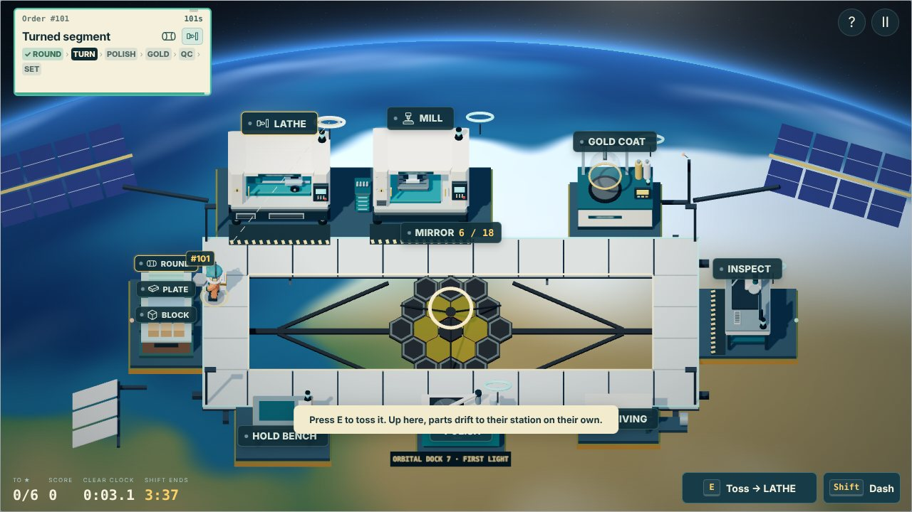
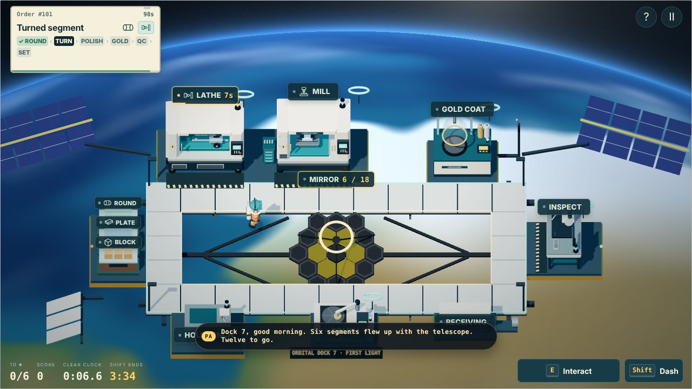

# First Light (`first-light`)

A Claude Fable 5.2 / Claude Code submission. Second edition, revised after the
creator played the first. Final submission; unreleased.

## Identity and starting conditions

| Item | Actual run |
| --- | --- |
| Date | 10 November 2026 |
| Starting commit | `b75515400cef3f68ce761609e0ba653bebbe9cee` (`main`, PR #34), seven catalog entries, six playable shifts plus Open for Business |
| Model / harness | Claude Fable 5.2 in Claude Code (cloud session, CLI 2.1.322). The credit is what the session reports for itself; the creator did not supply or confirm it |
| Development | Linux container, Git, Node 22.23.4, pnpm 11.9.0, Python 3.13.18; no new package installed |
| Art tools | Procedural Three.js r169 and one GLSL fragment shader. Blender is not installed and was not needed |
| Audio tools | Browser Web Audio and deterministic arithmetic. NumPy 2.5.3 and FFmpeg 6.1.1 are available and were not used |
| Browser | Headless Chromium through Playwright, software WebGL (SwiftShader), 1280×720 and 860×540, station-label clicks and real key events. No GPU and no audio output |
| External services | None. No downloaded art, recordings, paid media or web research |
| Delegation | None. One agent did the design, code, art, score, tests and this record |
| Human direction | The creator's whole brief was the repository and "You should have the experiment instructions to continue this game. Impress me." No concept, mechanic or setting was supplied. The creator then played the first edition twice and gave the feedback recorded under Iteration; no fix was prescribed |

Differences from the shared offer: no interactive browser for the model, no
hardware GPU, and nothing could be listened to. The creator's playtest is the
only human play.

## Creative intent

The rocket in Launch Window carried something. Last Light turned back toward
the people coming home. First Light looks the other way: the payload was a
space telescope with six of its eighteen mirror segments, and the shop goes up
to an orbital dock to make the other twelve. The name answers the previous
chapter's. On the night side of the pass, a light on the coast below flashes
twice every four seconds; the PA says what it is.

**The new verb is the toss.** Nothing falls in orbit, so a part does not have
to be carried. E is the whole control: standing at the station a part needs,
it hands the part over; anywhere else, it tosses the part there, and it drifts
at a steady 3.2 units a second while the machinist does something else.
Clicking a station does the same. A dashed line runs from the hands to where
the part will go, the button reads what E will do ("Toss → POLISH"), and a
part in the air carries its order number and a trail. Each machine has a catch
ring that holds one part, adrift or waiting, and loads it the moment the
machine is empty.

**The floor is a ring around a well, and the well can be crossed.** The
walkway runs around the telescope's mirror with the planet turning underneath.
Stock is on the west side, the lathe, mill and gold chamber along the back,
Inspection on the east, and the polisher on the front edge. There is no deck
in the well: step off the edge and the machinist floats across, slower than
walking (3.3 against 4.4) but far shorter than the lap. So each trip is a
choice between walking the ring, floating across, and tossing from where you
stand.

**The mirror is the shipping station and the objective.** A tested segment is
tossed into the mirror from anywhere, or handed over from anywhere beside it,
and takes the next of twelve outer slots. While a finished segment is in hand,
the mirror's own ring and the next empty slot light up. Six clear,
nine and twelve earn the higher stars. Each segment plays its own note; the
twelve in order are the level's melody, and the music adds a layer at two,
six and nine segments.

**The ending is the picture.** When the shift ends, the lamps go down, the
segments settle from their small individual tilts into one surface, and the
telescope looks. Each segment first makes its own blurred copy of one star,
laid out like the mirror (what a segmented telescope really sees before
alignment). The copies walk onto each other while the shift's notes replay,
then the sky behind the star comes into focus. Fewer segments make a dimmer,
softer picture; below six the copies never stack and the picture stays out of
focus. It is skippable, does not run the shift clock and cannot install
anything.

**Covari** supplies the sunshield membrane: thin-film lamination, which has no
station on the dock. Shared rules unchanged (optional, after two set
segments, 22 s delivery to Receiving, QC, 300 points, no slot or star credit).
A cargo capsule brings it; set in the mirror, five film layers unfold beneath
it.

Implemented numbers: see [level-design.md](../level-design.md#first-light-first-light).

## What changed

- `dist/orbit.js`: `FirstLightGame` (engine `orbit`), `SEGMENTS`, toss and
  catch-ring rules. Stock, Hold bench, Receiving, scoring, clear split and
  Covari are ShopGame's own code.
- `dist/assets/orbital.js`: the dock, mirror, sunshield, capsule, polisher,
  gold chamber, carried segment, suit, and the planet-and-sky shader.
- `dist/firstlight.js`: the ending picture, drawn on a canvas from a fixed seed.
- `dist/audio.js`: three synthesized stems in D Lydian at 80 BPM, four cues
  and the twelve segment notes.
- `dist/main.js`: map `orbital-dock`, toss input, flight and ring placement,
  tickets, labels, PA lines, day-to-night lighting, the ending and results.
- `dist/core.js`: catalog entry at legacy index 7 and `ORBIT_SOURCE_JOBS`.
- Tests: `qa/first-light.test.mjs` (31 cases), `qa/first-light-balance.mjs`.

## Wider game contributions

Small, and each used by this level:

- **Per-map station model.** `stations[id].variants` lets a map stand a
  different model in for a shared station. The mirror is Shipping on this map,
  so its clicks, label, access point and next-step highlight are the shared
  ones. Other maps keep their original model; their draw calls are unchanged.
- **Per-map label anchor** (`def.label`). A front-row station's label can sit
  below it, so it does not cover the machinist standing behind it.
- **`orderWorkflow(order, programming, ops)`** takes the station table of the
  level in play. Default behaviour is unchanged.
- **Per-map float zone** (`MAPS[id].float`): floor that is crossed at a
  slower speed. Only this map has one; `updateMovement` is otherwise unchanged.
- **Layered music is no longer Launch Window only.** `ShopAudio` picks stems,
  loop length and layer table by track. Launch Window's stems, layers and
  resume offset are covered by the existing audio tests, which pass unchanged.

No released level's rules, timing, layout, score bounds or camera changed.

## Data compatibility

`first-light` appends at legacy index 7; indices 0 to 6 are untouched. It uses
the shared ruleset, so its scores join the shift board under their own shift
name with no schema change or migration. Saves grow by one slot: older saves
load with a zero there, and `unlocked` still means "everything" for anyone who
has played First Shift. Challenge links for index 7 validate against 12
shipments. The hosted validator needs no change: it builds the level's own
rules through `shiftGame()`.

## Iteration log

1. **Concept.** Chosen before any code: orbit, the toss, the mirror as the
   objective, the picture as the ending. Rejected along the way: a line-of-sight
   rule for tosses (stations around a well are nearly always in sight, so it
   would be a rule that never fires), parts ejecting themselves from machines
   (too hands-off), and a day/night rule for the gold chamber (a second timed
   window straight after Last Light's crossings).
2. **First render.** The dock was 11 units wide and the camera had room for
   19. Widened the ring and the well. This also made the lap long enough that
   tossing matters: at the first width, walking around was as fast as a toss.
3. **Found in the browser and fixed:** the mirror stood rotated 90° (it
   inherited the conveyor's rotation); gold reflecting a physically black sky
   rendered green, so the reflection is a warm studio sky instead; front-row
   labels covered the machinist; the PA banner covered the back-row labels;
   the sky shader cost about 1.5× Last Light's frame in software rendering,
   and was cut to parity by shading only the lit or only the dark side per
   pixel and dropping an octave.
4. **Balance.** First timing left the twelfth segment unspawned for an expert
   route. Arrivals moved to 8 s then every 13 s, deadline 85 s, clock 215 s.

Everything above was the model's own review.

### Second edition: after the creator played it

The creator played the first edition twice and reported, as a player:

- the pack on the machinist's back flickers;
- it is overwhelming at first; a second run was clearer and a strategy formed;
- several times a part "just disappeared out of my hand", or went into
  something and nothing came out;
- the place to hand a finished segment to the telescope is undefined;
- the ring makes the run from the machines to the polisher "the longest run",
  the same cycle every time, with "nothing to optimize" and "no chance to
  avoid this";
- the look is good, and wanting to see the end result do well was real.

No fix was prescribed. The model's reading: the toss was the level's whole
idea and it had not landed. It was bound to a click and to F, so a keyboard
player walked every part round the ring, which is exactly the tedium
described, and a click that did toss looked like a part vanishing. The ring
then offered one route and no decision. Changes, all by the model:

1. **E tosses.** At the part's next station E hands it over; anywhere else it
   tosses it there. F and the separate Toss button are gone from the screen (F
   still works). The Interact button now says what E will do.
2. **The toss is shown before and after.** A dashed aim line and a mark at the
   target while a part is held; red if that catch ring is taken. In the air the
   part is larger, lit, trailed and tagged with its order number; a waiting
   part's tag reads "waiting". The target station flashes "INCOMING", a ring
   catch reads "IN RING · LOADS NEXT", and the first stock pickup of a run
   says to press E.
3. **The well can be crossed.** The rail is gone; the machinist floats across
   either side of the mirror. Mill to polisher is about 8 units instead of 17.
   The ring is no longer the only route.
4. **The mirror has a hand-in.** It carries its own large catch ring, which
   pulses with the next empty slot whenever a finished segment is held, and a
   segment can be handed over from anywhere beside the mirror, on the deck or
   floating.
5. **The pack.** Its trim shared a face with the pack and the pack sat 5 mm
   off the torso and cast a shadow on it. The parts now stand clear of each
   other and the suit casts no shadow on the body it moves with.
6. **A calmer start.** The second order arrives at 12 s instead of 8, then
   every 14 s; deadlines are 90 s; the clock is 220 s. Twelve of twelve is
   still an expert route.
7. PA lines moved to the bottom left, where they cover no station.

Not changed: the route every segment takes. The creator found the sequence
repetitive; the model judged that the repetition hurt because it was all
walking, and addressed that rather than shortening the route. If it still
drags, the next thing to try is letting a ready machine send its part on by
itself.

## Evidence

**Automated.** 436 tests pass (405 before; 31 new). Existing tests changed
only where they pin the catalog size, the save-array length, the credit list,
or need a stub for a function this level adds to a block they extract.
`node qa/balance.mjs --rush --ignore-calls --expert --assert` and
`node qa/first-light-balance.mjs --assert` pass, as do `pnpm build` (standalone
and hosted), `pnpm deploy:dry-run` and `git diff --check`. The generic
balance sweep now plays First Light through the level's own driver, since its
driver does not know the toss.

**Reproducible simulation** (`node qa/first-light-balance.mjs`). Scripted
legal play on the production collision and path code; every finish is
accepted by the hosted validator. These are routes, not measurements of human
difficulty.

| Strategy | Set | Stars | Missed / unfinished | Score | Clear | Finish |
| --- | ---: | ---: | ---: | ---: | ---: | ---: |
| Carry by hand, serial, 1.5 s reactions | 2 | 0 | 5 / 2 | 816 | not cleared | 3:40.0 |
| Carry by hand, 0.5 s reactions | 7 | 1 | 1 / 2 | 2,666 | 3:16.2 | 3:40.0 |
| Toss, 1.0 s reactions | 7 | 1 | 1 / 2 | 2,655 | 3:13.1 | 3:40.0 |
| Toss, 0.5 s reactions | 10 | 2 | 0 / 1 | 5,268 | 2:23.4 | 3:40.0 |
| Toss, 0.1 s reactions, dash | 12 | 3 | 0 / 0 | 7,274 | 2:11.6 | 3:21.7 |
| Toss, 0.5 s reactions, Covari accepted | 9 + sunshield | 2 | 0 / 2 | 4,830 | 2:23.5 | 3:40.0 |

Second-edition numbers; every driver floats across the well at the game's
float speed. With the crossing, carrying by hand now clears at a steady pace
(it set 6 in the first edition's ring and barely cleared), and tossing at the
same pace still sets three more. Accepting Covari costs this greedy route one
segment.

**Browser.** An accelerated review controller ran the game's own frame logic
(movement, collision, ticks, events) and acted only through station labels and
the ticket's Covari button. No part, score or state was injected. The
second-edition run in the pictures below: 11 segments set, 0 missed, 6,577
points, two stars, clear at 2:17.1, finished at 3:26.4, sunshield deployed,
then the ending and results. Separately checked with real key events and no
mouse: walk to the bin, E to take stock (the button then reads
"Toss → LATHE" and the first-run tip shows), E again to toss, and walking off
the deck to float. Also the picker entry and credit, the briefing,
pause and resume, the narrow 860×540 layout, and the standalone file opened
from `file://`. No page errors or console warnings in any run. The controller
and its debug hook were injected by the test harness at load and are not in
the repository.

**Asset provenance.** All geometry, the shader, the ending picture and the
score were written for this level in this run. The pictograms and UI follow
the existing game. The hexagonal segmented mirror, gold coating, kite-shaped
sunshield and six-plus-two diffraction spikes are how real segmented space
telescopes look and behave; no image, model, texture or sound from any such
mission is used.

## Known limitations and untested

- **The second edition has not been played by a person.** The creator played
  the first. Whether E-to-toss and the crossing fix what they felt is theirs to
  judge; no difficulty or enjoyment claim is made.
- **Not heard.** The score and cues are checked numerically (length, loop
  point, headroom), not by ear.
- **No real GPU.** Rendering was checked in software WebGL only. Colour, the
  shader's cost on integrated graphics and 60 Hz feel are unverified.
- **Touch and phones** are unverified. Tapping a station tosses, as clicking
  does.
- The lighthouse passes in the right-hand margin, which a window narrower than
  about 16:10 does not show.
- A segment adrift at closing is unfinished, as an unfinished crossing is in
  Last Light. That may feel harsh in the last second.
- The leaderboard was not exercised against D1 or the local SQLite server;
  the validator was tested directly.

## Release

Final submission. Not released; creator acceptance pending. Draft PR #35 from
`ccr-2efedbeb-n7f24r`; no merge, deployment, migration or public score.
