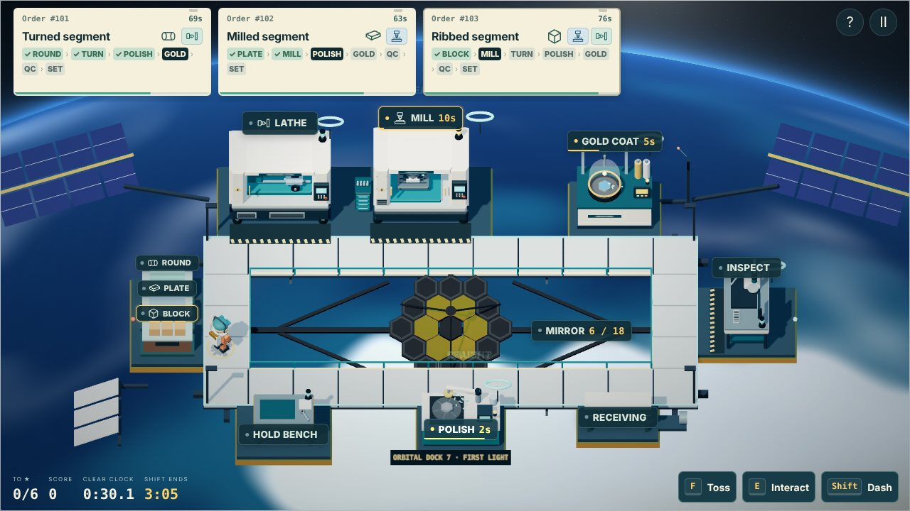
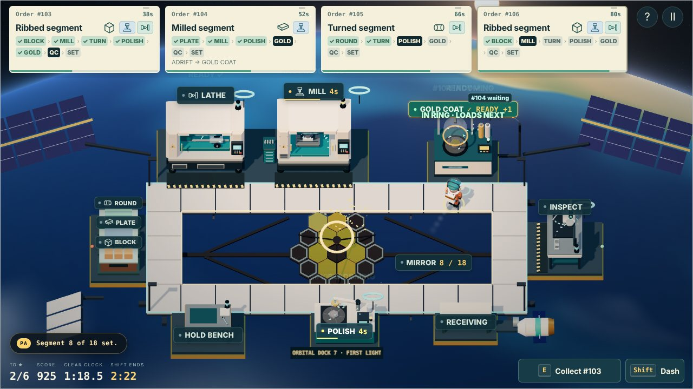
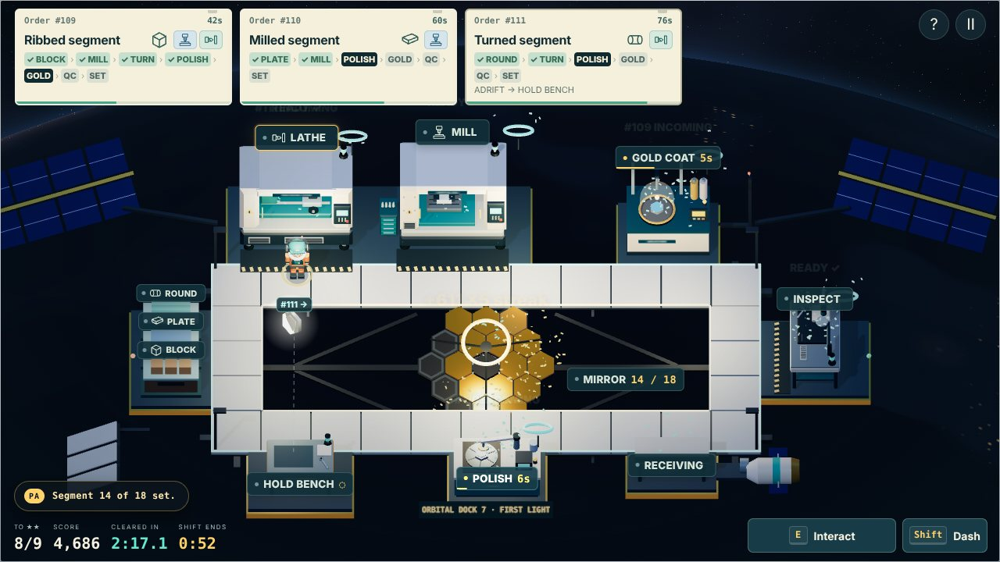
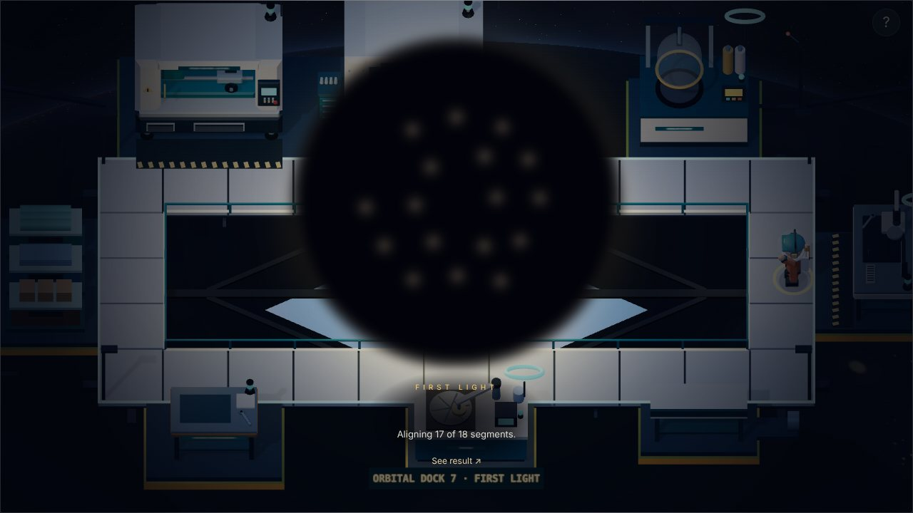
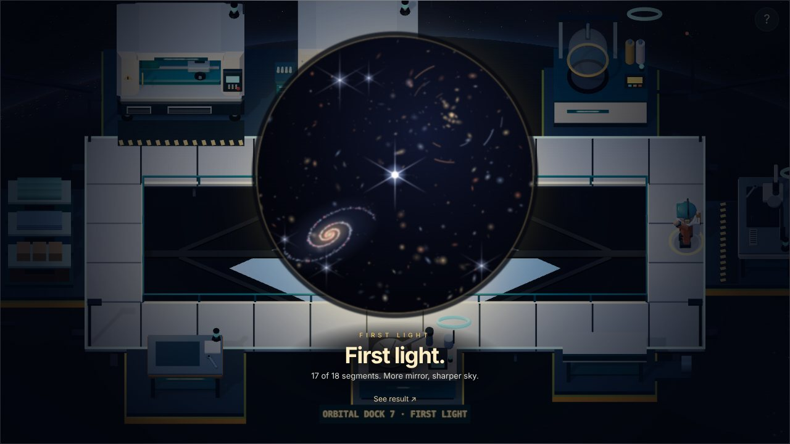
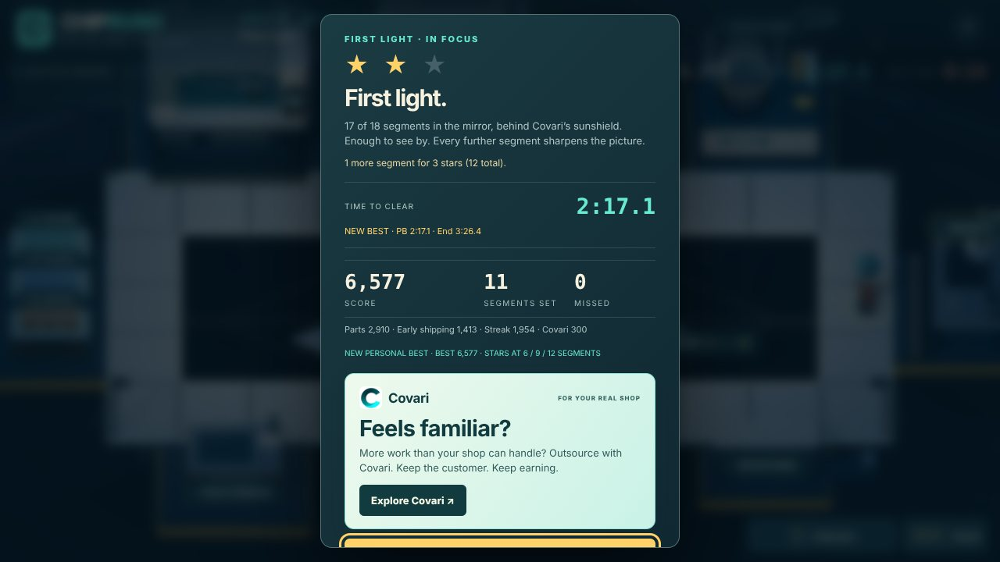

# First Light (`first-light`)

A Claude Fable 5.2 / Claude Code submission. Local build for creator review; unreleased.

## Identity and starting conditions

| Item | Actual run |
| --- | --- |
| Date | 10 November 2026 |
| Starting commit | `b75515400cef3f68ce761609e0ba653bebbe9cee` (`main`, PR #34), seven catalog entries, six playable shifts plus Open for Business |
| Model / harness | Claude Fable 5.2 in Claude Code (cloud session, CLI 2.1.322). The credit is what the session reports for itself; the creator did not supply or confirm it |
| Development | Linux container, Git, Node 22.23.4, pnpm 11.9.0, Python 3.13.18; no new package installed |
| Art tools | Procedural Three.js r169 and one GLSL fragment shader. Blender is not installed and was not needed |
| Audio tools | Browser Web Audio and deterministic arithmetic. NumPy 2.5.3 and FFmpeg 6.1.1 are available and were not used |
| Browser | Headless Chromium through Playwright, software WebGL (SwiftShader), 1280×720 and 860×540, station-label clicks and real key events. No GPU and no audio output |
| External services | None. No downloaded art, recordings, paid media or web research |
| Delegation | None. One agent did the design, code, art, score, tests and this record |
| Human direction | The creator's whole brief was the repository and "You should have the experiment instructions to continue this game. Impress me." No concept, mechanic or setting was supplied |

Differences from the shared offer: no interactive browser and no human
playtest inside the run, no hardware GPU, and nothing could be listened to.

## Creative intent

The rocket in Launch Window carried something. Last Light turned back toward
the people coming home. First Light looks the other way: the payload was a
space telescope with six of its eighteen mirror segments, and the shop goes up
to an orbital dock to make the other twelve. The name answers the previous
chapter's. On the night side of the pass, a light on the coast below flashes
twice every four seconds; the PA says what it is.

**The new verb is the toss.** Nothing falls in orbit, so a part does not have
to be carried. With a part in hand, click the station it needs next (or press
F) and it drifts there at a steady 3.2 units a second while the machinist does
something else. Each machine has a catch ring that holds one part, adrift or
waiting, and loads it the moment the machine is empty. Walking a part over and
handing it in still works, and a busy machine takes one part into its ring by
hand.

**The floor is a ring.** The walkway runs around a well with the telescope's
mirror in it, and the planet turns underneath. Stock is on the west side, the
lathe, mill and gold chamber along the back, Inspection on the east, and the
polisher on the front edge, so every segment crosses the well twice in the
air: back to front for polishing, front to back for gold. A lap of the ring is
about 37 units; a toss across the well is about six. Walking the ring while
parts cross it is the level's rhythm.

**The mirror is the shipping station and the objective.** A tested segment is
tossed into the mirror and takes the next of twelve outer slots. Six clear,
nine and twelve earn the higher stars. Each segment plays its own note; the
twelve in order are the level's melody, and the music adds a layer at two,
six and nine segments.

**The ending is the picture.** When the shift ends, the lamps go down, the
segments settle from their small individual tilts into one surface, and the
telescope looks. Each segment first makes its own blurred copy of one star,
laid out like the mirror (what a segmented telescope really sees before
alignment). The copies walk onto each other while the shift's notes replay,
then the sky behind the star comes into focus. Fewer segments make a dimmer,
softer picture; below six the copies never stack and the picture stays out of
focus. It is skippable, does not run the shift clock and cannot install
anything.

**Covari** supplies the sunshield membrane: thin-film lamination, which has no
station on the dock. Shared rules unchanged (optional, after two set
segments, 22 s delivery to Receiving, QC, 300 points, no slot or star credit).
A cargo capsule brings it; set in the mirror, five film layers unfold beneath
it.

Implemented numbers: see [level-design.md](../level-design.md#first-light-first-light).

## What changed

- `dist/orbit.js`: `FirstLightGame` (engine `orbit`), `SEGMENTS`, toss and
  catch-ring rules. Stock, Hold bench, Receiving, scoring, clear split and
  Covari are ShopGame's own code.
- `dist/assets/orbital.js`: the dock, mirror, sunshield, capsule, polisher,
  gold chamber, carried segment, suit, and the planet-and-sky shader.
- `dist/firstlight.js`: the ending picture, drawn on a canvas from a fixed seed.
- `dist/audio.js`: three synthesized stems in D Lydian at 80 BPM, four cues
  and the twelve segment notes.
- `dist/main.js`: map `orbital-dock`, toss input, flight and ring placement,
  tickets, labels, PA lines, day-to-night lighting, the ending and results.
- `dist/core.js`: catalog entry at legacy index 7 and `ORBIT_SOURCE_JOBS`.
- Tests: `qa/first-light.test.mjs` (26 cases), `qa/first-light-balance.mjs`.

## Wider game contributions

Small, and each used by this level:

- **Per-map station model.** `stations[id].variants` lets a map stand a
  different model in for a shared station. The mirror is Shipping on this map,
  so its clicks, label, access point and next-step highlight are the shared
  ones. Other maps keep their original model; their draw calls are unchanged.
- **Per-map label anchor** (`def.label`). A front-row station's label can sit
  below it, so it does not cover the machinist standing behind it.
- **`orderWorkflow(order, programming, ops)`** takes the station table of the
  level in play. Default behaviour is unchanged.
- **Layered music is no longer Launch Window only.** `ShopAudio` picks stems,
  loop length and layer table by track. Launch Window's stems, layers and
  resume offset are covered by the existing audio tests, which pass unchanged.

No released level's rules, timing, layout, score bounds or camera changed.

## Data compatibility

`first-light` appends at legacy index 7; indices 0 to 6 are untouched. It uses
the shared ruleset, so its scores join the shift board under their own shift
name with no schema change or migration. Saves grow by one slot: older saves
load with a zero there, and `unlocked` still means "everything" for anyone who
has played First Shift. Challenge links for index 7 validate against 12
shipments. The hosted validator needs no change: it builds the level's own
rules through `shiftGame()`.

## Iteration log

1. **Concept.** Chosen before any code: orbit, the toss, the mirror as the
   objective, the picture as the ending. Rejected along the way: a line-of-sight
   rule for tosses (stations around a well are nearly always in sight, so it
   would be a rule that never fires), parts ejecting themselves from machines
   (too hands-off), and a day/night rule for the gold chamber (a second timed
   window straight after Last Light's crossings).
2. **First render.** The dock was 11 units wide and the camera had room for
   19. Widened the ring and the well. This also made the lap long enough that
   tossing matters: at the first width, walking around was as fast as a toss.
3. **Found in the browser and fixed:** the mirror stood rotated 90° (it
   inherited the conveyor's rotation); gold reflecting a physically black sky
   rendered green, so the reflection is a warm studio sky instead; front-row
   labels covered the machinist; the PA banner covered the back-row labels;
   the sky shader cost about 1.5× Last Light's frame in software rendering,
   and was cut to parity by shading only the lit or only the dark side per
   pixel and dropping an octave.
4. **Balance.** First timing left the twelfth segment unspawned for an expert
   route. Arrivals moved to 8 s then every 13 s, deadline 85 s, clock 215 s.

No creator feedback yet. Everything above is the model's own review.

## Evidence

**Automated.** 431 tests pass (405 before; 26 new). Existing tests changed
only where they pin the catalog size, the save-array length, the credit list,
or need a stub for a function this level adds to a block they extract.
`node qa/balance.mjs --rush --ignore-calls --expert --assert` and
`node qa/first-light-balance.mjs --assert` pass, as do `pnpm build` (standalone
and hosted), `pnpm deploy:dry-run` and `git diff --check`. The generic
balance sweep now plays First Light through the level's own driver, since its
driver does not know the toss.

**Reproducible simulation** (`node qa/first-light-balance.mjs`). Scripted
legal play on the production collision and path code; every finish is
accepted by the hosted validator. These are routes, not measurements of human
difficulty.

| Strategy | Set | Stars | Missed / unfinished | Score | Clear | Finish |
| --- | ---: | ---: | ---: | ---: | ---: | ---: |
| Carry by hand, serial, 1.5 s reactions | 1 | 0 | 7 / 1 | 451 | not cleared | 3:35.0 |
| Carry by hand, 0.5 s reactions | 6 | 1 | 3 / 0 | 1,998 | 3:27.6 | 3:27.6 |
| Toss, 1.0 s reactions | 7 | 1 | 2 / 1 | 2,485 | 3:12.5 | 3:35.0 |
| Toss, 0.5 s reactions | 11 | 2 | 0 / 0 | 5,672 | 2:28.7 | 3:33.8 |
| Toss, 0.1 s reactions, dash | 12 | 3 | 0 / 0 | 6,821 | 2:01.7 | 3:18.8 |
| Toss, 0.5 s reactions, Covari accepted | 8 + sunshield | 1 | 1 / 1 | 3,599 | 2:45.5 | 3:35.0 |

At the same pace, tossing sets almost twice what carrying does. Accepting
Covari cost this greedy route three segments: the capsule, QC and the extra
toss compete for the same hands. A better route may lose less; that was not
searched for.

**Browser.** An accelerated review controller ran the game's own frame logic
(movement, collision, ticks, events) and acted only through station labels and
the ticket's Covari button. No part, score or state was injected. The run in
the pictures below: 11 segments set, 0 missed, 6,172 points, two stars, clear
at 2:15.8, finished at 3:22.9, sunshield deployed, then the ending and
results. An earlier run of the same controller set 10 for 5,437. Separately checked with real input events: the picker
entry and credit, the briefing, F to toss with and without a part in hand,
pause and resume, the narrow 860×540 layout, and the standalone file opened
from `file://`. No page errors or console warnings in any run. The controller
and its debug hook were injected by the test harness at load and are not in
the repository.

**Asset provenance.** All geometry, the shader, the ending picture and the
score were written for this level in this run. The pictograms and UI follow
the existing game. The hexagonal segmented mirror, gold coating, kite-shaped
sunshield and six-plus-two diffraction spikes are how real segmented space
telescopes look and behave; no image, model, texture or sound from any such
mission is used.

## Known limitations and untested

- **Nobody has played it.** No human difficulty, readability or enjoyment
  claim is made. Whether clicking a station to toss is discovered without
  reading the tip is the first thing to watch.
- **Not heard.** The score and cues are checked numerically (length, loop
  point, headroom), not by ear.
- **No real GPU.** Rendering was checked in software WebGL only. Colour, the
  shader's cost on integrated graphics and 60 Hz feel are unverified.
- **Touch and phones** are unverified. Tapping a station tosses, as clicking
  does; there is no on-screen Toss button on phones.
- The lighthouse passes in the right-hand margin, which a window narrower than
  about 16:10 does not show.
- A segment adrift at closing is unfinished, as an unfinished crossing is in
  Last Light. That may feel harsh in the last second.
- The leaderboard was not exercised against D1 or the local SQLite server;
  the validator was tested directly.

## Release

Not released. Creator acceptance pending. Draft PR #35 from
`ccr-2efedbeb-n7f24r`; no merge, deployment, migration or public score.
