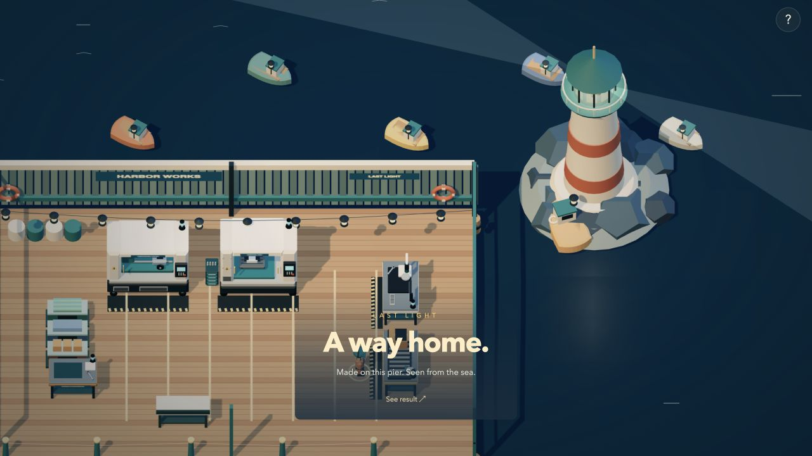
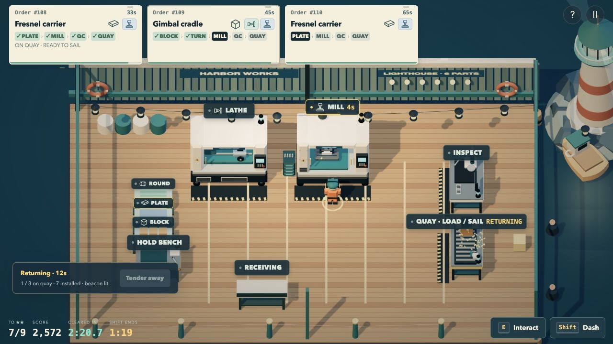
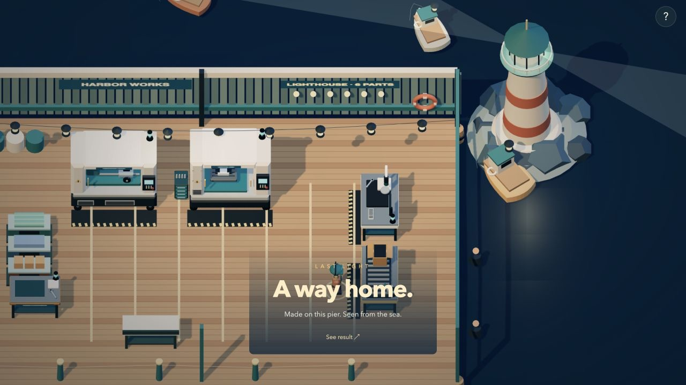
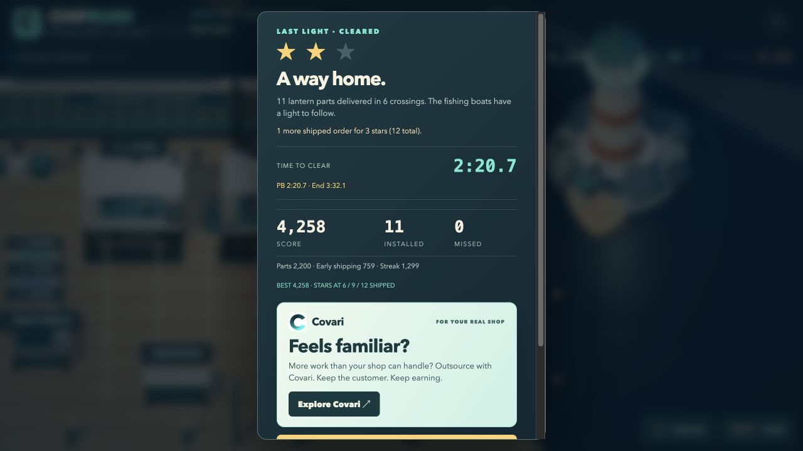

# Last Light (`last-light`)

A GPT-6.1 Sol / Codex submission. Local build for creator review; unreleased.

## Identity and starting conditions

| Item | Actual run |
| --- | --- |
| Date | 15 October 2026 |
| Starting commit | `60c24d0325d7cf4a5b06fd74af45213049b4696b`, PR #31, including unreleased Launch Window and the approved shop-first start screen |
| Model / harness | GPT-6.1 Sol, Codex desktop; exact desktop version not recorded |
| Development | Local macOS checkout, Git, Node 24.19.0, Python 3.14.4, existing project dependencies; no new package install |
| Art tools | Procedural Three.js; Blender not installed. All new geometry and staging authored for this level |
| Audio tools | Browser Web Audio and deterministic arithmetic; FFmpeg and NumPy available but not needed for the new track |
| Browser | Codex in-app browser, Chromium/WebGL, default 1280×720 pane; station clicks, screenshots, automation available |
| External services | No paid media, downloaded art, stock recordings, or external research used |
| Human direction | Creator requested one main level per model, First Shift exempt, freedom to surprise/entertain and an extraordinary coherent contribution; no level concept supplied |

The primary Sol agent selected the concept and owned the engine, world,
interaction design, integration and final acceptance. Same-model Codex agents
assisted with (1) retirement/compatibility and legal movement/balance evidence,
(2) the original harbor composition and audio regression checks, and (3)
independent engine unit cases, delegated by the QA agent. Those are material
contributions, not exclusive unaided authorship. No other model was used.

## First edition: creative direction

After the launch, look back toward the people who are still waiting to get
home. A little machine shop can build a rocket's hardware; it can also make
one light work again. The world moves to a timber pier, with a corrugated
workshop, warm cable lamps, a lighthouse on basalt, a small working tender,
fishing boats, gulls and a low copper sun. The piece is intentionally quieter
than the rocket finale, with its own mechanical decision and earned ending.

The tender changes what shipping means. Load up to three inspected parts onto
the quay, then use the quay again with free hands to sail. A one-part crossing
can light the tower sooner; a fuller batch leaves more time for manufacturing.
Deadlines run on the quay and stop aboard. Points and the speedrun split happen
at arrival, after 12 seconds. The boat takes 12 more to return. Continue cutting
during both legs. Each installed part adds a lantern rib; four turn the light
on. The ending follows its beam and the boats coming home.

The three recipes are lantern spindles, Fresnel carriers and gimbal cradles.
The floor has no optical grinder; an optional customer optic goes through
Covari, Receiving, QC and the tender, for the existing 300-point bonus without
star credit. Existing levels retain their own behavior. The new stable ID
appends at legacy index 6. Mixed Orders' retired slot stays index 1; historical
scores are labeled, never reassigned. See [level-design.md](../level-design.md)
for the implemented timings and rules.

## Iteration

1. Retained Rush Hour as Astra's main entry because it builds on stock/CAD/
   scheduling with competing customer promises. First Shift remains the intro.
   Mixed Orders was removed from playable entry points and new score posting.
2. Updated the shared brief to make model-owned creative direction, beauty,
   entertainment and surprise explicit, without prescribing the next concept.
3. Built the harbor engine, then its diorama, dispatch ticket, original score
   and skippable ending. Browser review caught a startup initialization-order
   bug and an inverted lighthouse roof; both were corrected before acceptance.

## First edition: evidence and limitations

The full suite passes 387 tests. Eighteen engine cases cover normal shipping
versus arrival, carried-part preservation, pause, expiration, three-slot
capacity, sourcing, closing boundaries, cleanup and reset isolation. Two
additional cases cover leaving the ending without leaking the terminal game
mode into results. Retirement entry points, score boundaries, original levels
and existing audio remain covered.

`node qa/beacon-balance.mjs --assert` runs legal collision-checked walking,
stock pickup, all actual cutting/QC operations, loading and dispatch. Every
finished result is also accepted by the hosted score validator. Reproducible
simulations (not observed player ability):

| Strategy | Installed | Clear time | Full finish | Crossings |
| --- | ---: | ---: | ---: | ---: |
| Slower serial, walking, 1.5s reactions | 7 | 2:05.68 | 4:00.00 | 7 |
| Normal overlap, walking, 0.5s reactions | 8 | 1:52.21 | 3:32.00 | 8 |
| Expert, single sends | 8 | 1:48.83 | 3:27.57 | 8 |
| Expert, batches of three | 8 | 2:31.98 | 3:17.18 | 3 |

This demonstrates the intended tradeoff: batching finishes the total work
sooner while single sends can clear faster and retain more early-delivery
points. Eight-part mastery is attainable by the normal scripted overlap;
this is not a claim about human difficulty. Normal Covari play also installs
eight ordinary parts and earns exactly 300 sourcing points. A twelve-scenario
sweep of slower play, late starts and batch choices passed server validation.

An accelerated browser controller clicked the production station controls and
used their real collision-safe movement and game ticks: eight deliveries,
6,354 points, clear 1:49.5, finish 3:28.5. No finished parts or scores were
injected. The winning lighthouse reveal and full result were observed. The
transient controller only accelerated frames and chose normal UI actions; it
is absent from the release and was removed by reloading the preview. Its local
point/star/speed records were removed without touching earlier user records. A
reproducible engine simulation is separate from this rendered integration test.

Desktop and 860×540 narrow-window rendering were checked; the dispatch ticket
does not overlap stock or Hold controls. Full mobile-device play remains
unverified. The standalone (including browser startup) and hosted builds, Worker dry run, generic Rush Hour expert
balance assertion and whitespace checks passed. Harbor audio has numerical
headroom/seam/transition checks; a listening judgment remains for the creator.

The creator subsequently played this edition; see the revision below. No human success-rate or
listening claim is made. No public score, production migration, deployment or
merge was performed for this submission. PR #31 still includes migration 0003
for shared clear/end timing; this level needs no further schema change.

## Second edition: crossing windows

The creator's first playthrough found the camera too distant, flickering boats
with little payoff, an initially unclear lighthouse objective, and an extremely
easy run. The calm music was noticed. The creator supplied no prescribed fix,
but gave Sol another chance to reconsider its contribution. This revision was
made by the primary GPT-6.1 Sol agent without additional subagents.

The shop now fills the play camera. Offshore objects cannot expand its frame,
and the ending keeps its scale. Boat hulls and decks have separated surfaces;
boat meshes no longer receive the self-shadows that can shimmer on their small
facets. Each installed part sends a fishing boat along the quay during play.
The lighthouse begins glowing with the first delivery; six large progress
lamps inside the shop make its objective visible where the player works.

Dispatch now has safe crossing windows: 12 seconds open in every 36, starting
at 0:20. The tender still takes 12 seconds each way and carries up to three.
Up to twelve orders arrive, with a 10-second first gap, then 12-second intervals,
65-second deadlines and a 220-second clock. Six parts clear; nine and twelve
are mastery targets. The intended tension is preparing a batch before the
window closes while keeping the floor moving. The original harbor music stays.

The legal collision-aware balance driver produced these reproducible results;
these are scripted routes, not human difficulty measurements:

| Strategy | Installed | Missed / unfinished | Clear | Finish |
| --- | ---: | ---: | ---: | ---: |
| Serial single sends, 1.5s reactions | 4 | 6 / 2 | failed | 3:40.00 |
| Walking overlap, 0.5s reactions, batches of two | 11 | 0 / 0 | 2:23.63 | 3:32.08 |
| Expert dash, 0.1s reactions, batches of two | 12 | 0 / 0 | 1:44.00 | 3:32.06 |
| Expert dash, 0.1s reactions, batches of three | 12 | 0 / 0 | 2:23.10 | 3:32.16 |
| Walking overlap with Covari | 11 + optic | 0 / 0 | 2:22.30 | 3:32.10 |

All five finished snapshots pass the hosted result validator. The optional
optic remains exactly 300 points without star credit. Normal overlap produced
eleven eligible arrivals; expert scheduling allowed the full twelve. The
late-arrival check now budgets both machining and the next crossing window.

The edition is `last-light-v2-crossings`. New scores, challenges and clear-time
records use that edition. Old point/star records are archived in the existing
local save, old clear times remain stored, and old public rows keep their old
star thresholds with a first-edition label. Database schema is unchanged by
this revision; PR #31 still requires its additive timing migration before deploy.

Human acceptance of this revision is pending. No production migration,
deployment, public score or merge was performed.

Second-edition integration evidence: an accelerated rendered browser run used
normal station clicks, actual movement, machining and dispatch, with no forged
parts or scores. It delivered eleven parts with zero misses, scored 4,258,
cleared at 2:20.7 and finished at 3:32.1. The earned close-view ending, results,
optional leaderboard skip and persisted edition-specific speed record were
observed. Test records were removed selectively afterward, preserving the
existing First Shift record and saved business. The transient controller was
removed by reloading. Both 1280×720 and 860×540 layouts were inspected; a compact
crossing strip avoids the lathe controls in the smaller window. Full mobile
play and a new human playthrough remain unverified.

All 396 automated cases pass, including window boundaries, safe arrivals,
first-edition record preservation, new-edition posting, real boat geometry and
fleet movement. Both balance assertions, standalone and hosted builds, Worker
dry run and whitespace checks passed. This verifies implementation and
scripted playability; the creator judges the experience.
