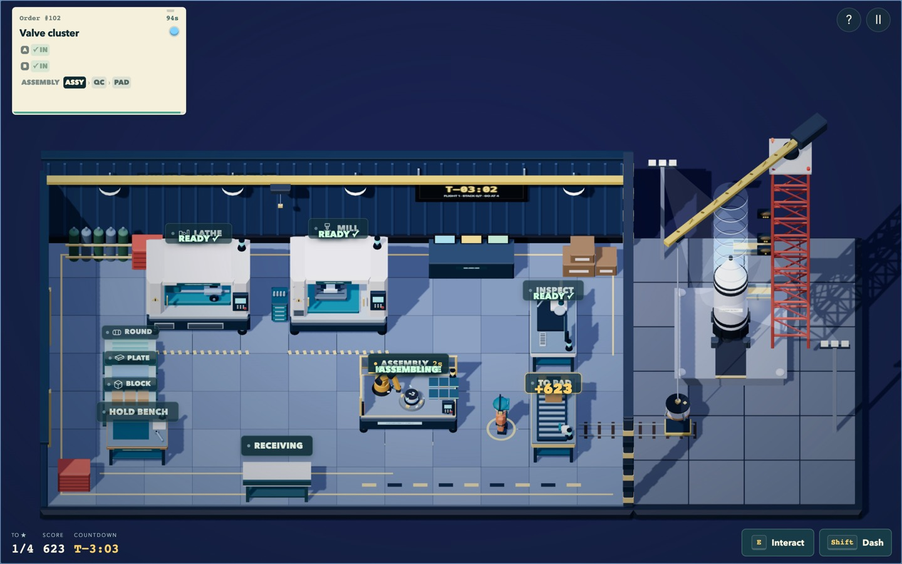
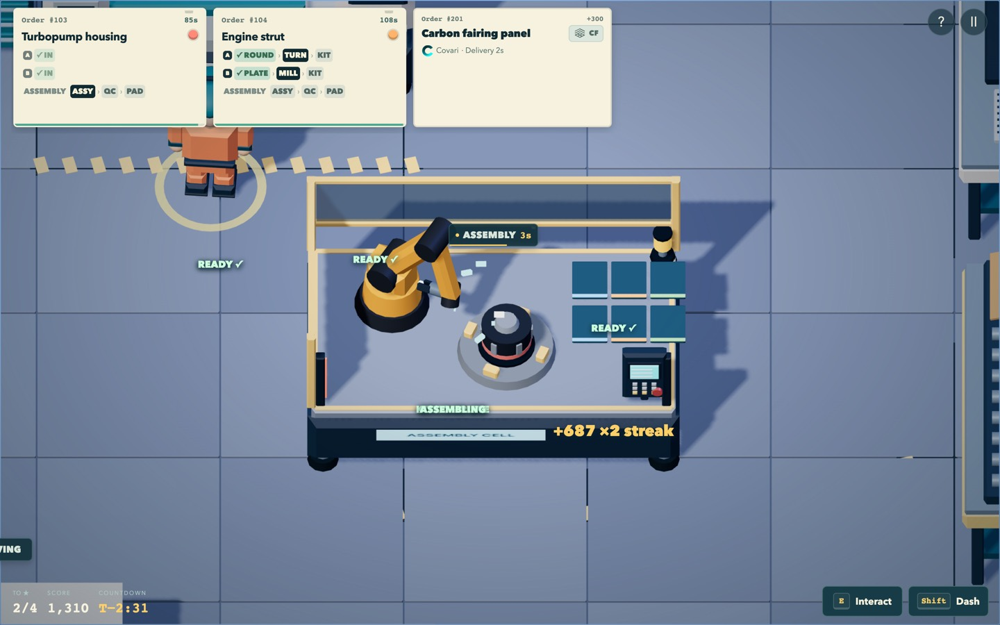
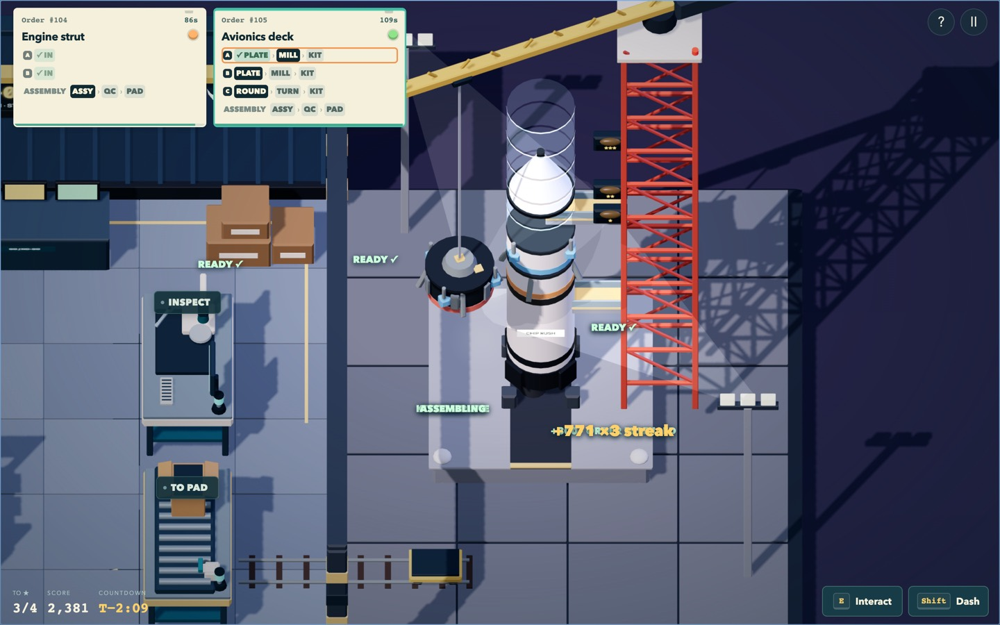
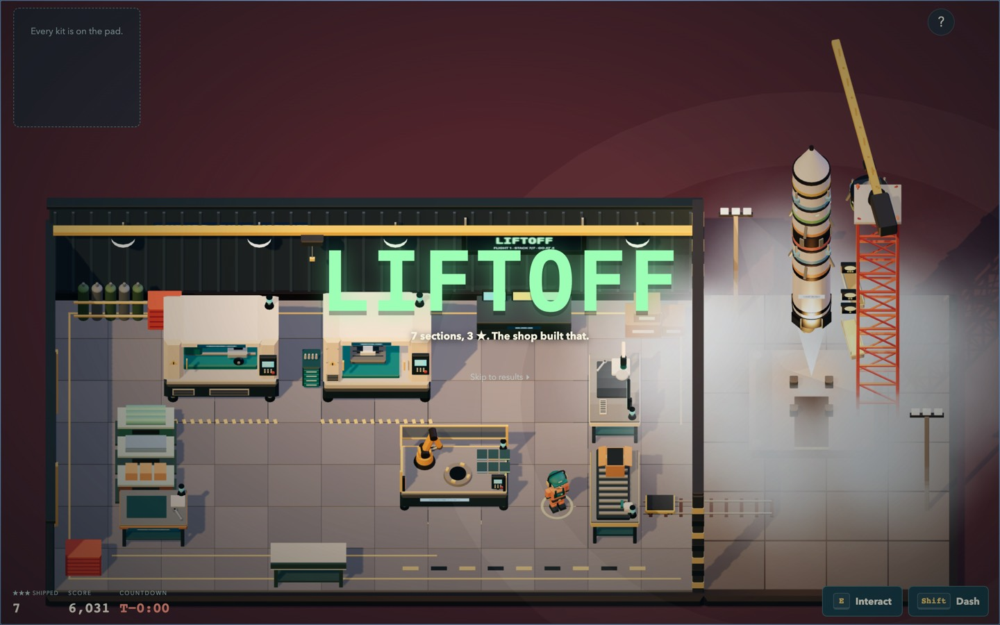

# Launch Window (`launch-window`) experiment record

Legacy index 5. Sixth level, appended after Blackout Shift (PR #30). This is a
development record; creator playtest, approval and release are open.

## Identity

| Field | Value |
| --- | --- |
| Level | `launch-window` / **Launch Window**, map `launch-pad`, rules `engine:'launch'` (`LaunchGame` in `dist/launch.js`) |
| Base commit | `9f5d270`, the head of PR #30 (`covidawn-shift-4d43`, Blackout Shift by Gemini 4): four released levels plus Blackout Shift at index 4 and the `open-for-business` mode. First built on `main` (`5d01251`), then rebuilt on the PR when the creator pointed out it was the intended base |
| Model | Claude Opus 5.5 (`claude-opus-5-5`), as reported by the run's system context |
| Harness | Claude Code 2.1.299, desktop app (Code tab), local macOS checkout |
| Date | 2026-10-14 |
| Delegation | None. No subagents or other models. All design, code, models, music, simulation and verification were done in this one session |

Launch Window was built on Blackout Shift. PR #30 has since merged into
`main`; this PR includes the sixth level and the entry/speed-record update. `LaunchGame` finds its level by `engine`, not by index; if
the order of unreleased levels changes, only `SHIFTS`, the test constant
`LAUNCH` and index-based test fixtures move.

## Conditions

| Condition | Offered / confirmed | Used |
| --- | --- | --- |
| Starting game | Full source, tests and docs; `node --test` 305/305 and the balance assertions passed on the base commit | Yes |
| Development | Git, Node 22.23 (tests, builds) and Node 24.19 via nvm (`scripts/dev-server.mjs` needs `node:sqlite`), pnpm 11.9 (offline store), Python 3.14 with NumPy 2.4.3, FFmpeg | Yes |
| Playtesting | Claude Code's built-in browser pane (Chromium, hardware WebGL) on the local dev server. The pane was hidden for most of the run, which throttles `requestAnimationFrame`, so play was driven by a temporary local stepper that ran the production `frame()` with simulated time (removed before commit). Full-resolution captures used an already-installed `playwright-core` 1.60 with the cached Chromium 1243 (Metal ANGLE) | Yes. Station-label paths, interactions and the whole terminal count ran in the real renderer |
| 3D assets | Procedural Three.js in `dist/assets/models.js`. Blender not installed | All new geometry is procedural code |
| Music and sound | Python/NumPy + FFmpeg (as the country loop), Web Audio | New generator and three stems; new synthesized cues |
| Research | Web available | Not used |
| Human iteration | None yet. No human has played this build | n/a |

## Creative intent

Blackout Shift ends with a coastal storm knocking out the grid before dawn
and the shop running on its backup generator. **Launch Window** is the morning
after: the same storm scrubbed a launch down the coast, the sky has cleared for
the rescheduled dawn window, and the launch team is short of flight hardware.
The shop that kept its floor running through the blackout gets the call and
works from the hangar beside the pad. The PA opens with "Weather is go: last
night's storm has cleared the range." Blackout Shift's light runs from storm
toward dawn; Launch Window's runs from blue hour to sunrise. The countdown clock is the shift clock, and every order you ship
is lifted onto the rocket.

The creator's feedback on an earlier run of this experiment was that adding a
machine to the same room is not a new level. So this level adds no machine.
It changes the shape of an order and gives the shift a visible destination:

1. **Kits, not parts.** Every order is a kit of two or three parts. Each part has
   its own stock and a short lathe/mill route, and all of them end at the new
   **robot assembly cell**. The cell takes parts at any time, holds them on its
   trays, and assembles a kit by itself the moment its last part arrives (6 s).
   The assembly is inspected and sent to the pad. The question changes from
   "which machine next?" to "which kit can I complete, and which part is the
   slow one?" Converging parts is a real manufacturing step the game didn't have.
2. **The rocket is the score you can see.** The pad sits beside the hangar's
   open east side. A shipped assembly rides a cart out of the door, and a
   slewing jib crane on the launch tower lifts it. The nose cone rises out of
   the way and the section is set into the stack, with sparks and a PA call.
   Each section is a full-size copy of the miniature you carried: a turbopump
   housing is dark with vanes, an avionics deck has status lights, a payload
   adapter has a cone. Faint "ghost" rings show the three-star rocket still to
   be built, and ★ / ★★ / ★★★ lamps on the tower light up as the stack reaches
   each target.
3. **A countdown with an ending.** The HUD reads `T−3:40`, and so does a live
   LED mission clock on the hangar wall. The light runs from blue hour to
   sunrise, and the PA calls milestones (propellant loading, range green, last
   loads). At T−10 the count goes terminal. With four or more sections the
   swing arms retract and the jib slews clear. Ignition fills the pad with
   exhaust cloud and an orange glow; at LIFTOFF a shock ring crosses the
   apron, the camera follows the rocket into the sky, and the overlay reads
   "7 sections, 3 ★. The shop built that." With fewer sections the board
   flashes HOLD, the count recycles and the launch **scrubs**. The rocket stays
   on the pad with its missing sections outlined. Finishing early skips
   straight to terminal count.
4. **Music that counts down with you.** An original 120 BPM D-minor score in
   three synchronised stems: a pad, a sub-bass pulse and a ticking clock; a
   rolling arpeggio with a kit; and a lead melody with four-on-the-floor kick
   and tom fills. The game layers them as the count advances: the base from
   the start, the drive once the shop is moving, and everything in the last
   minute. New cues mark a kitted part, the cell starting, a section stacking,
   countdown beeps, an ignition rumble, the liftoff roar and the scrub horn.

### World, objective, controls

- **Map `launch-pad`:** the workshop footprint (so shared stations, bounds and
  framing carry over) with a new shell. A ribbed hangar wall with bridge crane,
  high-bay lamps, gas bottle cage, GO / NO-GO console and the mission clock
  sits on a cooler epoxy floor. Striped posts frame the open east side, and the
  launch complex beyond it has the apron, rails and cart, the pad and flame
  trench, a lattice tower with swing arms, the jib crane and star lamps,
  floodlight masts with additive beams, and the rocket. There is no office
  (flight programs are locked, so no CAD). Lathe and mill move along the back
  wall, the assembly cell is mid-floor, and Shipping is labelled **TO PAD**.
  The camera frames named landmarks of the launch complex rather than its
  bounding box, so the play area stays about the size of earlier levels.
- **Objective:** ship 4 assemblies before terminal count (T−10). Stars at
  4 / 5 / 7. Duration 210 s of play (the clock shows T−3:40 because the last
  10 s are the terminal count). Up to 7 kits: arrivals at 0 s, 16 s, then
  every 23 s; deadline 115 s (+14 for the first). The four-active-order limit
  counts kits, not parts.
- **Kits** (`KITS` in `dist/launch.js`; parts → cell → QC → pad):

  | Kit | Parts (stock: route) | Value |
  | --- | --- | ---: |
  | Engine strut | Strut pin (round: lathe), Clevis plate (plate: mill) | 250 |
  | Valve cluster | Valve body (block: mill), Poppet stem (round: lathe) | 270 |
  | Turbopump housing | Pump housing (block: lathe → mill), Impeller shaft (round: lathe) | 330 |
  | Avionics deck | Deck plate (plate: mill), Mount bracket (plate: mill), Standoff (round: lathe) | 350 |
  | Payload adapter | Adapter ring (block: lathe → mill), Clamp band (plate: mill), Separation bolt (round: lathe) | 420 |

  Sequence: strut, valve, pump, strut, avionics, valve, payload adapter. The
  late-arrival check uses a generous kit time estimate. Near closing, a
  three-part kit is replaced by the shortest two-part kit that still fits, or
  nothing arrives.
- **Controls:** unchanged. Stock bins still hand over the earliest-due part of
  their type. Drop a part at the cell with Interact. If the cell has a finished
  assembly waiting, the same interaction collects it. Parts can be parked on
  the Hold bench, swapped at ready machines, and recycled at a bin; finished
  assemblies cannot go back to stock. Wrong stations explain the next step.
- **Tickets:** one card per kit, with a row per part (stock → machines → KIT;
  green when kitted) and an ASSEMBLY row (ASSY → QC → PAD). The desktop and
  mobile rails are taller in this level so three-part kits fit.
- **Scoring:** the shared formula, unchanged. Kit value + early shipping
  (seconds left × 4) + streak. No CAD points (no CAD) and no calls. A completed
  Covari job adds 300. Assembly does not score by itself; the kit scores when
  it reaches the pad. An expired kit takes all of its parts with it, wherever
  they are, and counts as one miss.
- **Ending:** time-up or early finish both start the terminal count.
  `LaunchGame.launchDecision()` is `go` at the clear target, otherwise `scrub`.
  "Skip to results", Space, Enter or Escape skip the sequence.

### Covari capability gap

The pad has a lathe, a mill and an assembly cell, but no metal printer,
composite cell or friction-stir welder. After two shipments (the shared rules:
≥35 s in, ≥45 s left, 30 s to decide, 22 s delivery to Receiving, QC, 300
points, no slot, star or streak credit) the level offers one of
`LAUNCH_SOURCE_JOBS`:

- **Printed injector**, metal 3D printing (AM): "No metal printer at the pad"
- **Carbon fairing panel**, carbon fiber layup (CF): "No composite cell at the pad"
- **Welded tank dome**, friction stir welding (FSW): "No stir welder at the pad"

Each has a new original badge icon in `dist/technology.js`. When it reaches
the pad, the PA announces it. It earns points but adds no rocket section.

## What changed

- `dist/launch.js` (new): `LaunchGame extends ShopGame`. Kits are parent orders;
  their parts are child entries of `this.orders` whose clock reads the kit's,
  so stock dispatch, machine loading, swaps, the Hold bench and recycling run on
  ShopGame's unchanged code. Overrides: `spawn`/`spawnRecipe` (kits, the
  four-kit limit, the late-arrival cut), `nextMaterial` (parts only), `interact`
  (the cell, plus clear messages where ShopGame would name an operation it does
  not know), `tick` (start a waiting kit), `expire` (cascade), `finish`
  (unfinished kits). Also `KITS`, `ASSEMBLY`, `LAUNCH_OPS`, and the `shiftGame()`
  factory used by the renderer, the server and the balance driver.
- `dist/core.js`: appended `SHIFTS[5]` (with `musicTrack:'launch'`) and
  `LAUNCH_SOURCE_JOBS`. Launch Window adds nothing to `ShopGame`; Blackout
  Shift's overdrive rules there are untouched.
- `dist/assets/models.js`: `makeAssembly` (robot cell with live arm pivots,
  trays, guard fence and light curtain), `createAssembly` (assembly miniatures,
  also used scaled up as rocket sections), `createHangar` (hangar shell and the
  canvas-texture mission clock), and `createLaunchComplex` (apron, rails, cart,
  pad, lattice tower, swing arms, jib crane, star lamps, floodlights, rocket,
  ghosts, flame, glow and shock ring).
- `dist/main.js`: the `launch-pad` map (stations, placement, per-map fixed
  obstacles, shell switch, landmark framing), pre-dawn → sunrise themes, kit
  tickets, kitted-part trays, robot animation, the pad crane sequence, PA
  calls, the mission clock, terminal count and liftoff/scrub, the camera
  following the rocket, a `terminal` UI mode (60 fps budget during the
  sequence), launch result copy, briefing goal and the picker credit.
- `dist/audio.js`: merged with Blackout Shift's player. `setTrack()` now knows
  three tracks: the country loop, Blackout's synthesized storm loop and Launch
  Window's stems. As in Blackout Shift, `updateMusic()` picks the track from the
  level's `musicTrack` (and keeps it through the terminal count). The launch
  stems load lazily and play in sync; `setIntensity()` crossfades layers; new
  cues and a filtered-noise rumble. Country and storm behavior and their tests
  are unchanged.
- `scripts/music/generate_launch_music.py` (new) and three 112 kbps stems +
  QA JSON in `dist/assets/music/`.
- `dist/index.html`, `style.css`, `mobile.css`: PA banner, terminal-count
  overlay, kit ticket styles, taller launch rails, and the help entry.
- `server/worker.js`: the late-arrival probe uses `shiftGame()`, so kit levels
  validate with their own arrival rules.
- **`scripts/build-offline.mjs` (bug fix for every level):** the standalone
  `dist/CHIP-RUSH.html` on `main` never got past "Opening the shop…".
  `ReferenceError: HALLS is not defined`: Open for Business's south halls
  added imports to `main.js` that the bundler's hand-written binding list
  did not include. The bundler now generates each module's bindings from its
  own `import` lines (failing loudly on an unbundled import) and embeds every
  referenced music file.
- Tests: new `qa/launch-window.test.mjs` (20 tests). `qa/balance.mjs` builds games
  through `shiftGame()`, routes with each map's own access points, and for kit
  levels only lets the driver drop parts at a busy cell and swap at ready
  machines. Tests that pinned the level count now expect the appended sixth with the
  same intent (released IDs and order unchanged).

## Evidence

**Automated:** `node --test qa/*.test.mjs` passes 342/342 (322 on the PR head
+ 20 new). `node qa/balance.mjs --rush --ignore-calls --expert --assert` passes.
`pnpm build` and `pnpm deploy:dry-run` succeed (dry run only, nothing
deployed). New tests cover:

- the kit, cell, swap, expiry, early-finish, Covari and late-arrival rules
- the map's reachability between every pair of stations (production pathfinder)
- unchanged released maps
- server and challenge validation, and the save unlock
- stem loop QA and synchronised layered playback
- the standalone bundle's bindings

**Earlier levels unchanged:** the serial, flow and expert simulation results
(shipped, score, elapsed) of all five earlier levels, Blackout Shift included,
are identical to the PR head. A test pins the serial and flow rows. Rendering of earlier maps is
untouched; Night Shift draws 324 calls, Launch Window 366 (fewer triangles).

**Simulation** (`qa/balance.mjs`: production A* paths, walking speed, real
timers; scripted decisions, not players):

| Profile | Shipped / kits | Stars | Score | Covari | Missed / unfinished | End |
| --- | ---: | ---: | ---: | ---: | --- | --- |
| serial, 0.5 s | 5 / 7 | 2 | 3,091 | 0 | 0 / 2 | 210 s time-up |
| flow, 0.5 s | 6 / 7 | 2 | 4,291 | 0 | 0 / 1 | 210 s time-up |
| flow, 0.5 s, accept Covari | 6 / 7 | 2 | 4,509 | 1 | 0 / 1 | 210 s time-up |
| serial, 1.0 s | 4 / 7 | 1 | 2,296 | 0 | 1 / 2 | 210 s time-up |
| flow, 1.0 s | 6 / 7 | 2 | 3,891 | 0 | 0 / 1 | 210 s time-up |
| serial, 1.5 s | 4 / 7 | 1 | 2,125 | 0 | 1 / 2 | 210 s time-up |
| flow, 1.5 s | 5 / 7 | 2 | 2,953 | 0 | 0 / 2 | 210 s time-up |
| flow, 1.5 s, accept Covari | 4 / 7 | 1 | 2,479 | 1 | 1 / 2 | 210 s time-up |
| expert, 0.1 s + dash | 7 / 7 | 3 | 5,918 | 0 | 0 / 0 | 179.2 s early |
| expert, accept Covari | 7 / 7 | 3 | 6,126 | 1 | 0 / 0 | 182.1 s early |

Design intent, not a measured difficulty: every profile clears, overlapping
kits earns two stars, and the full seven-section stack is the mastery result,
as three stars are in Rush Hour. Outsourcing costs a slow player a star. The
flow driver is not an optimal player: it can leave a finished part waiting for
a busy machine, so its two-star result is a floor.

**Browser:**

- **Station flow.** In the built-in Chromium pane, one kit was played by
  clicking station routes: stock → lathe/mill → cell (one part kitted, label
  "1 IN KIT") → second part → robot assembling → collect → QC → TO PAD. The
  shipment scored +610, then the cart, jib, nose lift and stack sequence ran,
  with PA calls.
- **Full shift.** A small in-page bot played a complete shift through the same
  UI paths, accepting the Covari job: 7/7 shipped, 3 stars, 6,031 points,
  early finish at 182 s, no page errors. On the rebuilt branch, a real-time
  headless Chromium run clicking only station labels repeated it: 7/7 plus
  Covari, 5,875 points, finish at 188 s, then liftoff and "Full stack. Clean
  flight." with no errors. The same run started Blackout Shift and played it
  before switching levels. Liftoff, the camera follow and the
  results ran in order; scrub, skip and HOLD were run separately.
- **Layouts.** Desktop is 1280×800 and 1440×900 (2× captures). Mobile is
  740×360 (mobile interface); its tickets clipped and were fixed.
- **Standalone and server.** The standalone `CHIP-RUSH.html` boots and plays
  Launch Window. The local board creates runs for the new level.
- **Fixes found in browser play.** The camera frame, which was too zoomed out,
  now uses landmarks. Lighting was too dark. Tickets clipped. The first two kits
  could tie on deadline, which made dispatch order float-dependent; the
  second-arrival gap moved from 14 s to 16 s. The rocket flew through the jib
  crane, which now slews clear. A lamp covered the mission clock. The kit count
  label also counted the kit itself.

**Assets and provenance:** all geometry is procedural code. The three stems
are generated by `scripts/music/generate_launch_music.py` (seed 20261014): an
original composition and synthesis, with no samples or external music. Each
stem decodes to exactly 1,411,200 frames (32 s), has no clipped samples, and
has a loop seam under 0.003. The mix is −21 dBFS RMS. See
`dist/assets/music/launch-window-120.json`. I cannot listen to audio. The
music was checked only numerically and as a spectrogram, never by ear.

**Known limitations / untested:**

- No human playtest. Difficulty, readability at speed and the music's taste
  are unverified.
- Phone landscape (`data-phone=true`) layout was checked in CSS only, not in
  an emulated phone.
- Touch play, reduced motion, and hosted D1 beyond the local adapter were
  not exercised.
- The standalone file is 4.4 MB (the stems add about 1.8 MB).

## Iteration log

1. **Proposal and build:** kits + assembly cell + rocket stack + terminal count
   + layered countdown score; Covari for AM / CF / FSW. Built on `main` in a
   separate worktree (`claude/next-shift`).
2. **Self-review in the browser** (no creator feedback yet): the fixes listed
   under Evidence. Balance stayed at the profile above after the arrival change.
3. **Creator feedback:** "I forgot to mention a PR that was open. You were
   supposed to build on top of it." The level was rebuilt on PR #30 as level 6.
   The story now follows Blackout Shift (its storm scrubbed this launch). The
   music player merges the storm loop with the launch stems. Conflicts in the
   map table, labels, HUD, picker credits, briefing and tests were merged by
   hand so both levels keep their behavior.

## Release

The original level implementation is commit `5d2be52`, built on PR #30.
The creator approved the revised entry UI for PR preparation; a full human
Launch Window playtest remains open. No deployment has been performed.
The earlier `main`-based build stays on `claude/next-shift` for reference.
