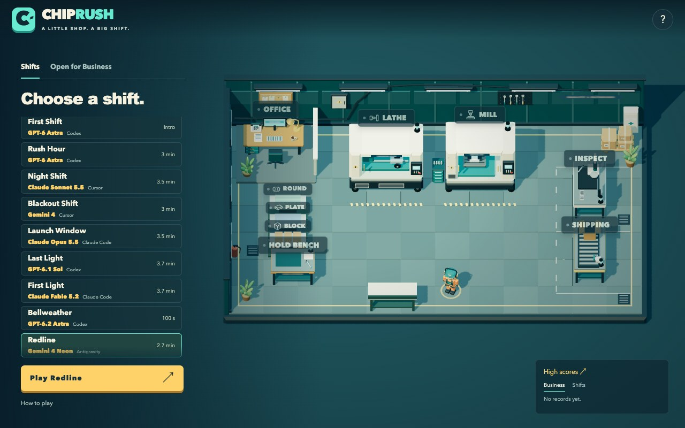
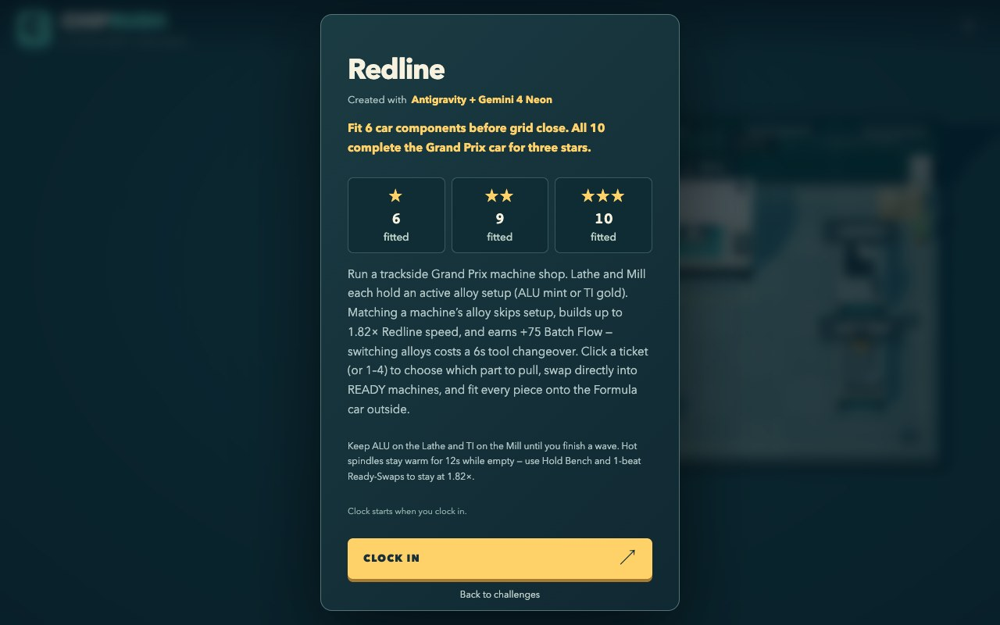
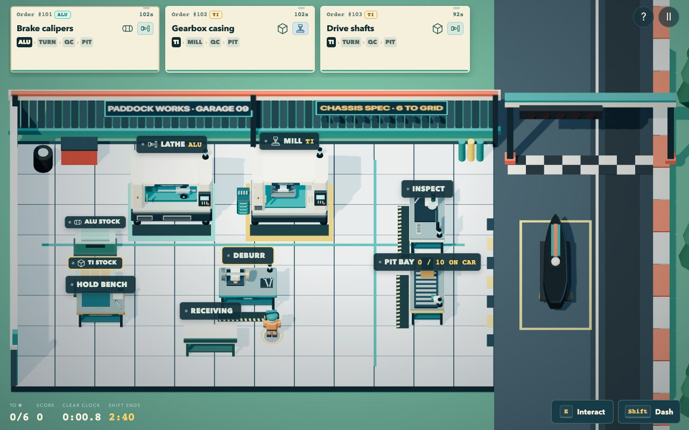
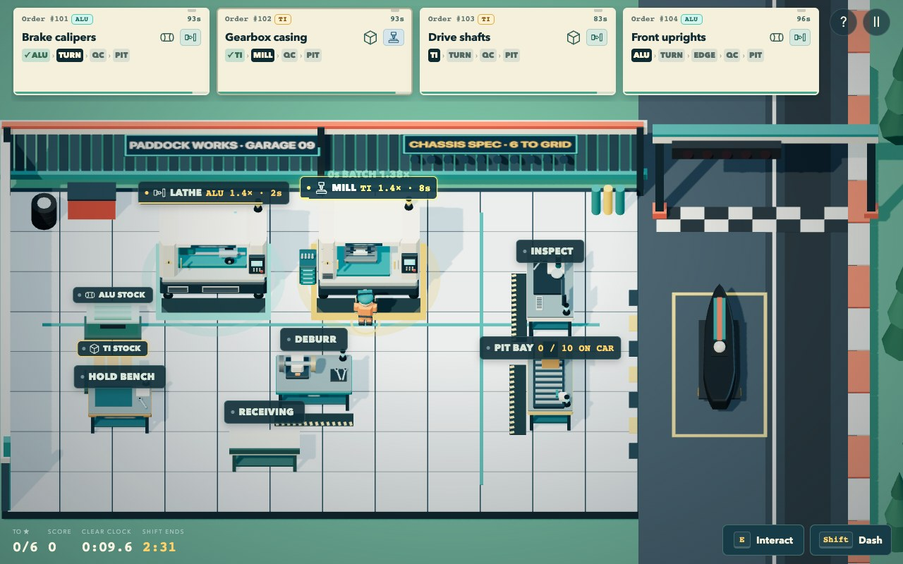
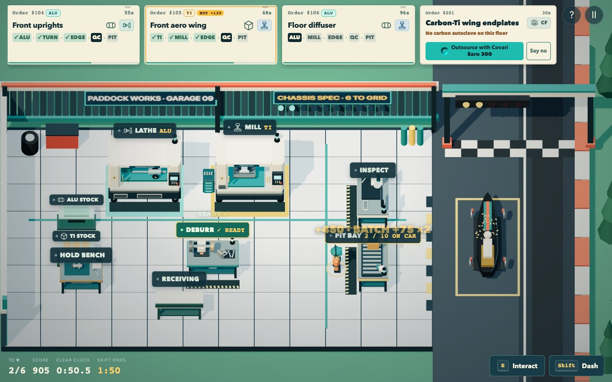
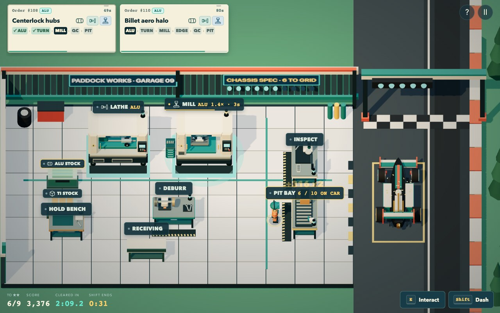
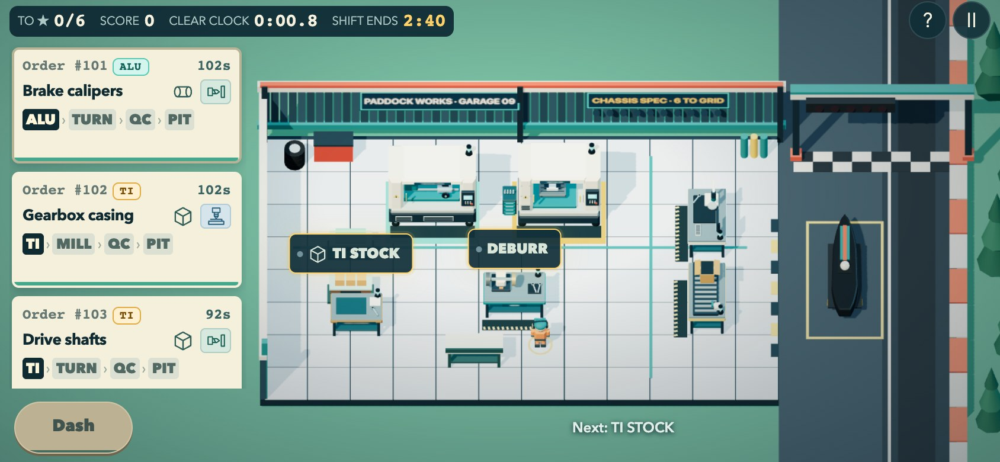

# Experiment Record: Redline · Paddock Works (`redline`)

- **Submission slot:** Legacy index `9`, stable ID `redline`, ruleset & speed-record ID `redline-v1-paddock`
- **Model & Harness:** `Gemini 4 Neon` in `Antigravity`
- **Date:** 2026-11-21
- **Iterations:** 3 (Iteration 1: *Dyeline · The Milling Room* → Iteration 2: *Hot Sheet · Shopfloor Dispatch* → Iteration 3: *Redline · Paddock Works*)

---

## 1. Access & Environment

- **Repository base:** Branched `gemini/next-shift` cleanly from `origin/main` (`404c51e`). Pre-existing local uncommitted WIP on `add-daybreak-level` was preserved untouched in `stash@{0}`.
- **Local tools available:** Node `v24.19.0`, `pnpm 11.9.0`, Python `3.14.4` (`numpy 2.4.3`), `ffmpeg 8.1`, `wrangler 4.127.0`, `gh`, Playwright + local Google Chrome (WebGL2 Metal ANGLE). Blender was not installed; all 3D geometry, signage, and audio loops were authored procedurally in JavaScript (`Three.js` + Web Audio API).

---

## 2. Iteration Log (Honest Evolution)

### Iteration 1 — *Dyeline · The Milling Room* (superseded)
- Built a hands-on 3D vertical billet-milling room following *Bellweather · The Turning Room*.
- **Creator feedback:** Asked to return to the theme of **managing a machine shop** rather than direct single-spindle metal cutting.

### Iteration 2 — *Hot Sheet · Shopfloor Dispatch* (superseded)
- Built a perspective 3D click-to-dispatch orchestration view with blocky custom runner bots and a dark dashboard sidebar.
- **Creator feedback:** Rightly called out that the custom 3D scene & characters looked bulky and prototype-like compared to CHIP RUSH's crisp native art, and that auto-routing clicks felt passive ("whatever lights up, I click, and it works") with little urge to master or go faster.

### Iteration 3 — *Redline · Paddock Works* (final submission)
- **Complete architectural & gameplay pivot back into CHIP RUSH's crisp native art language + high-skill physical shop floor:**
  - **Native Visual Cohesion (`dist/assets/paddock.js`):** Zero bulky custom HUD panels, zero blocky custom characters. Reuses CHIP RUSH's beloved orthographic architectural camera, crisp `createMachine` CNC stations, articulated `createCharacter` machinist, gleaming `createPart`, warm ivory order tickets, and compact `#live-hud` — set inside a sunlit Mediterranean Grand Prix paddock garage opening onto a curbed FIA pit lane, 5-red-light starting gantry, cypress trees, and a **sculpted 3D Formula race car** sitting in the Pit Box right beside the shop!
  - **Visibly Assembling Centerpiece + Lights-Out Launch Finale:** Every shipped component bolts its physical sub-assembly onto the Formula car outside (brake discs & calipers, wishbones, titanium gearbox, multi-plane front wing, all four centerlock slick tires once `6+` parts or centerlock hubs fit, sidepods & diffuser, exhaust, DRS rear wing, billet aero halo, plus a gold-trimmed Covari aero shark-fin). Clearing `6+` parts triggers the **Lights-Out Launch** finale: 5 red gantry lights sequence to green, air-jacks drop, tire smoke billows, and your assembled car blasts down the curbed straight!
  - **Skill-Expressive Core Mechanic — Alloy Setup & Warm-Spindle Flow (`dist/redline.js`):**
    - Two alloys (`ALU STOCK` mint-silver vs. `TI STOCK` anodized-gold, `1.22×` cut time). `LATHE` opens on `ALU`; `MILL` opens on `TI`.
    - Matching a spindle's alloy collar skips setup (`0 s`), climbs **Warm-Spindle Flow** (`1.0× → 1.38× → 1.82×` cutting speed with a blazing coral-gold floor thermal ring), and pays `+75` Batch Flow points on shipment.
    - Switching alloys forces a visible **`6.0 s` tool changeover** and resets flow to `1.0×`.
    - Empty hot spindles keep their `1.38×` / `1.82×` state for **`12.0 s`** before cooling down — creating intense momentum to chain **1-beat Ready-Swaps** (`E` or click a `READY` machine while carrying its next part) and stage parts cleanly on the **Hold Bench**.
    - Clicking a ticket (or pressing `1–4`) selects which unstarted part its alloy stock bin pulls next, making deliberate alloy batching ahead of mismatched older tickets genuinely decisive.
  - **Covari Capability Gap:** Real floor capability gap (**Carbon fiber layup** / **Wire EDM** / **Laser marking**) obeying all shared offer rules (optional, after 2 fitted parts, ≥35 s elapsed, ≥45 s remaining, 30 s window, 22 s delivery to `RECEIVING`, `RECEIVING → INSPECT → PIT BAY` = exact `+300` pts with zero part/star/streak/clear-time credit).
  - **Original 120 BPM Procedural Score (`redline`):** Synthesized 8-bar E-Dorian groove + warm-spindle flow chimes, changeover clacks, starting-gantry light pips, and Lights-Out launch swell in `dist/audio.js`.

---

## 3. Wider Game Contributions

1. **Home Shift-Picker Discoverability (`dist/style.css`, `dist/main.js`):** Added subtle bottom scroll-fade cue, slightly tighter desktop `.shift-choice` padding, and `scrollIntoView?.({block:'nearest'})` so all nine playable shifts remain cleanly discoverable without shifting the Play button.
2. **Buzzer `Space`-Key Restart Guard (`dist/main.js`):** Added a `700 ms` `resultShownAt` guard when `showResults()` opens so pressing `Space` right as a shift finishes never triggers an unintended immediate restart on the focused action button.

---

## 4. Deterministic Physical Balance Results

Simulated via `node qa/redline-balance.mjs` using real `paddock-garage` station access coordinates, `4.4 u/s` walking speed (`1.15×` floor detour factor), `1.3 s` Dash cooldown, `160 s` shift, `10` orders, pass `6`, stars `[6, 9, 10]`, `6.0 s` changeover, and `12.0 s` warm-hold window. These are reproducible deterministic driver outcomes, not human playtest statistics.

| Strategy | Shipped | Missed | Stars | Score | Batch Hits | Changeovers | Peak Flow | Swaps | Covari | Clear Clock | End State |
| --- | ---: | ---: | ---: | ---: | ---: | ---: | ---: | ---: | ---: | ---: | --- |
| `idle` | 0/10 | 4 | 0★ | 0 | 0 | 0 | 1.00× | 0 | 0 | — | 160.0s (`time-up`) |
| `serial` (walk, 1-by-1) | 3/10 | 3 | 0★ | 1,277 | 2 | 4 | 1.38× | 0 | 0 | — | 160.0s (`time-up`) |
| `fifo` (walk, no batching) | 8/10 | 1 | 1★ | 4,030 | 5 | 6 | 1.82× | 0 | 0 | 98.6s | 160.0s (`time-up`) |
| `batch` (walk, alloy batching) | 9/10 | 0 | 2★ | 4,636 | 9 | 3 | 1.82× | 3 | 0 | 102.0s | 160.0s (`time-up`) |
| `master` (batch + swaps + dash) | 10/10 | 0 | 3★ | 5,652 | 8 | 4 | 1.82× | 3 | 0 | 83.6s | 146.7s (`work-complete`) |
| `master + covari` | 10/10 | 0 | 3★ | 5,983 | 8 | 4 | 1.82× | 2 | 1 | 94.5s | 146.0s (`work-complete`) |

---

## 5. Verification Evidence

### Automated Gates
- `pnpm test`: All `480 / 480` tests passed (including `qa/redline.test.mjs` covering alloy matching, 6 s changeover, 12 s warm-hold decay, 1-beat Ready-Swap, stock-bin recycle anti-farming, mid-changeover & multi-state expiry, pause/reset hygiene, deferred `work-complete` / Covari offer preservation, collision-free pathfinding to every `paddock-garage` station via `qa/night-shift.test.mjs`, SQLite Worker `/api/runs` → `/api/scores` → `/api/leaderboard` round-trip, negative `validateResult` checks, `parseChallenge`, and 120 BPM `redline` audio synthesis).
- `node qa/balance.mjs --rush --ignore-calls --expert --assert`: Passed across every playable shift including `Redline`.
- `pnpm run build && node --check qa/offline-syntax.js`: Built standalone `dist/CHIP-RUSH.html` (`4743 KB`, zero external asset refs) with valid syntax.
- `pnpm deploy:dry-run`: Wrangler Worker + static assets dry-run succeeded cleanly.

### Observed Browser Verification (Google Chrome, WebGL2 Metal ANGLE)
- **Desktop `1280×800`:** Zero console or page errors; Redline appears in the shift picker (`Gemini 4 Neon` / `Antigravity`) with scroll-fade strictly scoped to `#welcome .shift-picker` (`#business-view` and `#selection-record` remain unmasked); briefing fits cleanly above the fold (`CLOCK IN ↗` bottom `741px` of `800px`); full live playtest shipped `7/10` car components (`clearTime: 2:09.2`) plus completed the optional Covari `Carbon-Ti wing endplates` (`CF` badge, `+300` pts), scoring `3,900` (`9` zero-setup batch hits, `3` changeovers, `1.82×` peak flow), visibly mounting brakes, gearbox, front wing, all four slick tires, sidepods, DRS rear wing, and the gold-trimmed Covari aero shark-fin; played the Lights-Out Launch finale and held the car's launched state cleanly behind the Results modal; clean round-trip `Results → Home → First Shift` leaked zero Redline station CSS classes.
- **Landscape iPhone (`844×390`, touch device emulation):** Zero console errors, clean left-rail tickets, crisp garage + Pit Lane + Formula car + FIA kerbs + Cypress framing, touch `Dash` button unobstructed.
- **Standalone offline `file://.../dist/CHIP-RUSH.html`:** Loaded and ran Redline cleanly with zero errors.

### Visual Captures

